
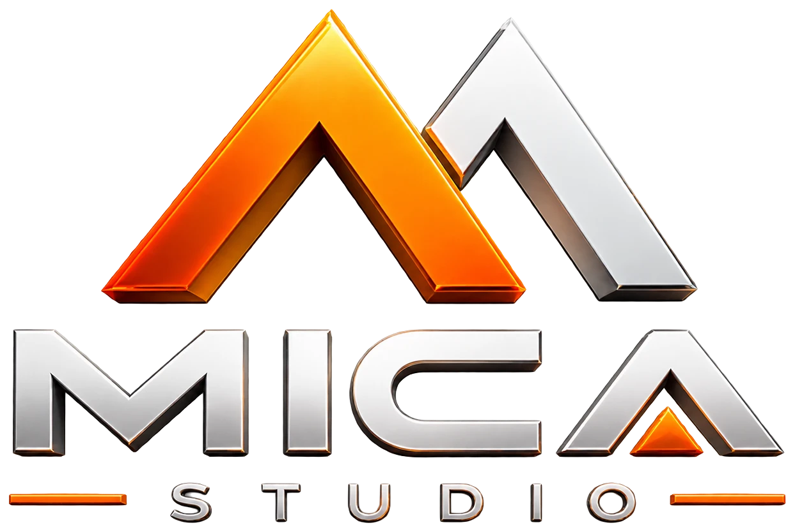

<h3 align="center">An offline ERP for a plywood and laminate gallery, built end to end.</h3>

Purchases and sales · stock as a passbook · order-first selling · dispatch · receipts with advances · party ledgers · audited real data · encrypted backups 
<b>Desktop · fully offline · one installer · no cloud server</b>

> **Showcase repository.** This page tells the story and shows the product. The source code is private by design and is not published here.
> All screens and the video use made-up demo data.

---

## Watch it

**[▶ The full tour (video, about 9 minutes)](video/mica-studio-tour.mp4)** — every feature, driven live in the real app, with the story behind each chapter.

[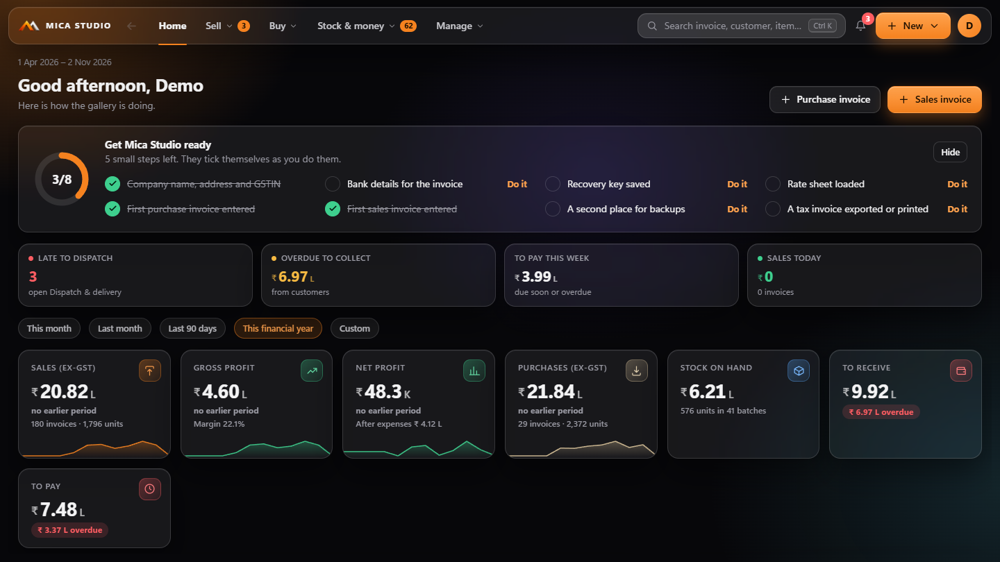](video/mica-studio-tour.mp4)

## The story

The whole journey, decision by decision (the brief, stock as a passbook, two people on one set of books with no internet, the audit of the real data, the corrections file, the stock reset, receipts with advances) is in **[docs/JOURNEY.md](docs/JOURNEY.md)**.

Everything the product does, screen by screen, is in **[docs/FEATURES.md](docs/FEATURES.md)**.

## A look inside

| | |
|---|---|
| 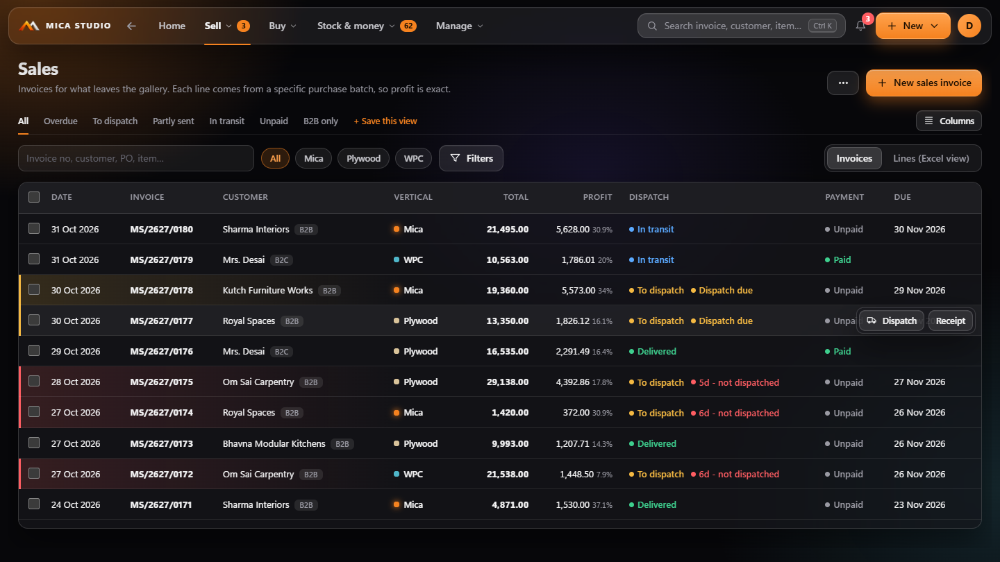 | 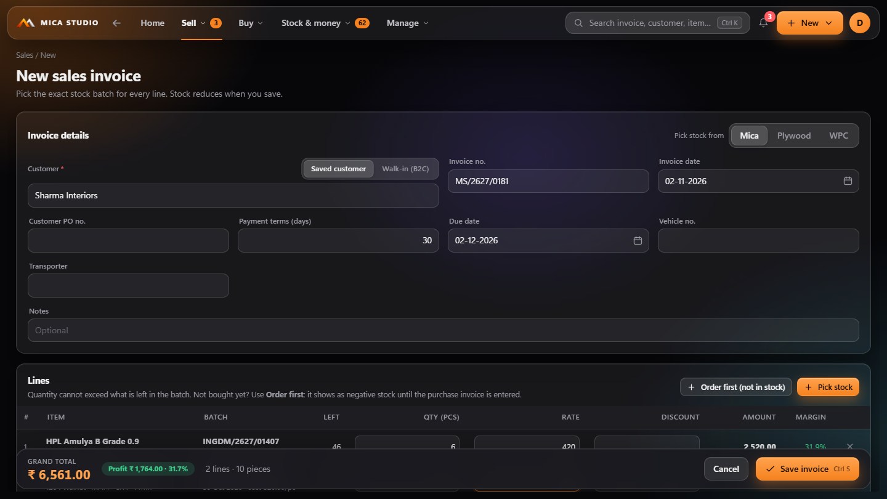 |
| **Sales**: profit, dispatch and payment status on one line | **A new invoice**: the exact batch behind every line |
| 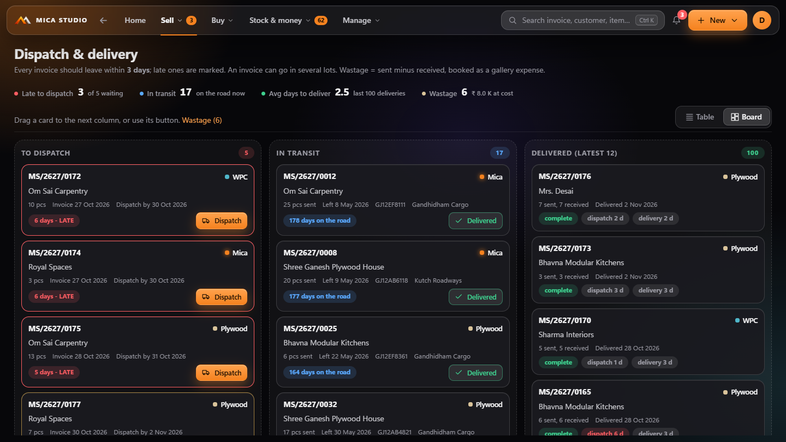 | 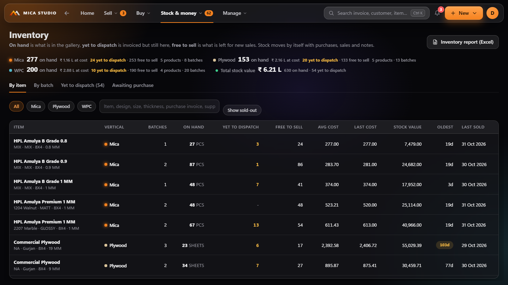 |
| **Dispatch board**: late, on the road, delivered | **Stock**: on hand, yet to dispatch, free to sell |
| 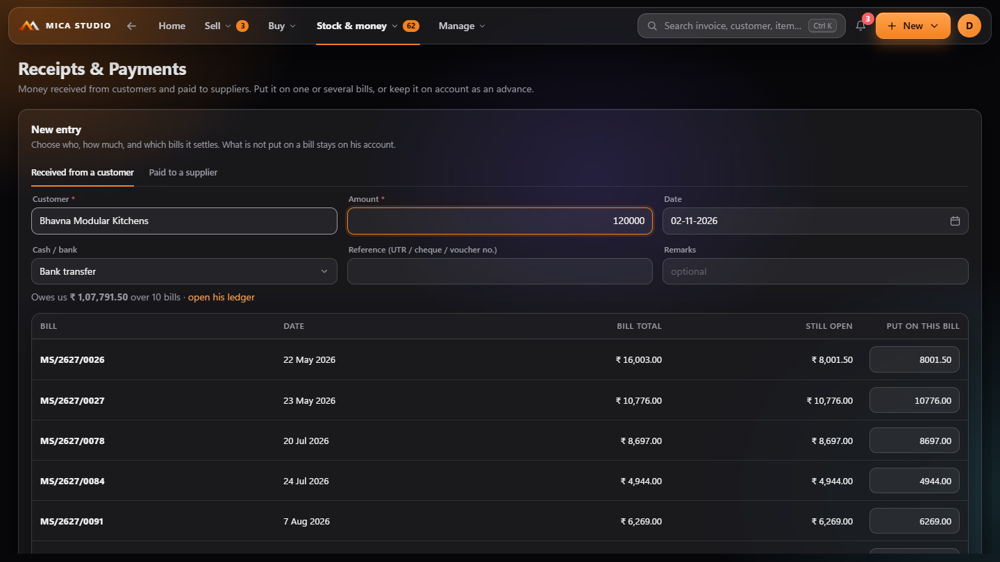 | 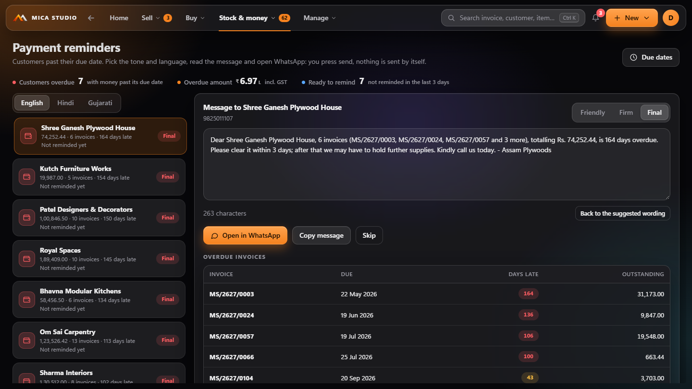 |
| **Receipts & payments**: one lump sum over many bills, the rest on account | **Reminders** in English, Hindi and Gujarati |
| 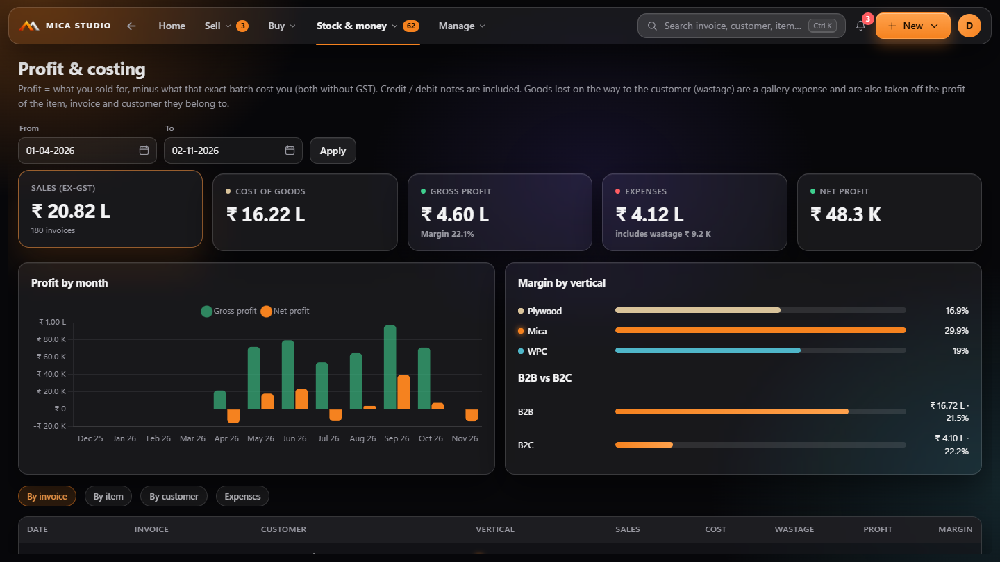 | 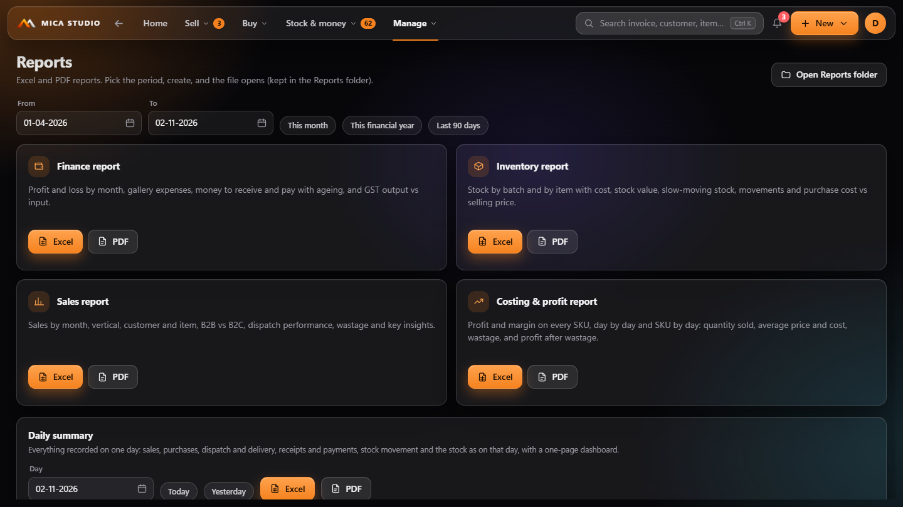 |
| **Profit and costing**: exact, because every line knows its cost | **Reports**: Excel and PDF |
| 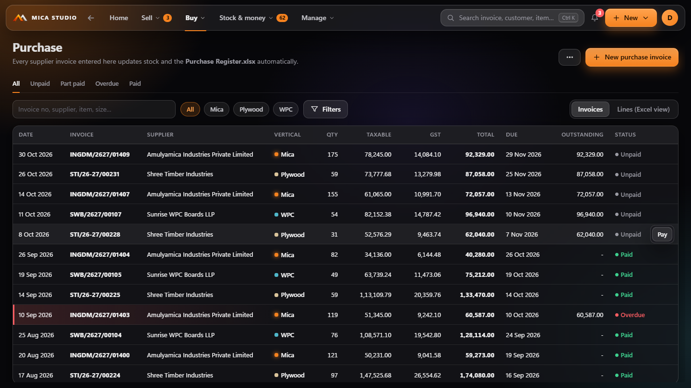 | 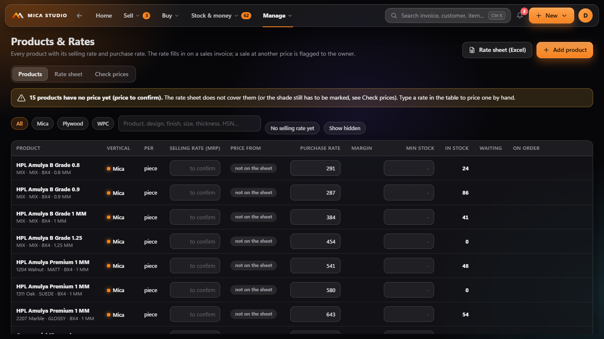 |
| **Purchases**: every supplier invoice with its stock and cost | **Products and rates**: the rate sheet as rules |

## How it is put together

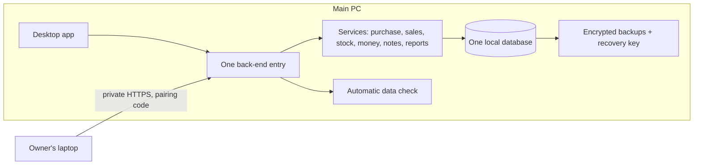

- **One live database** on one PC; other computers open the same program from it. No sync, no merge conflicts, no cloud.
- **Stock is a ledger** of movements; profit is the sale minus the cost of the exact batch sold.
- **Every correction is a previewed, repeatable step** that can be applied twice without doing anything twice.

## Facts

| | |
|---|---|
| Delivery | A single Windows installer |
| Data | Local, encrypted backups, automatic restore |
| Verticals | Plywood, WPC, Mica laminate (different line layouts) |
| Testing | Hundreds of automated checks, plus end-to-end tests that drive two real programs against each other |
| Languages | English, Hindi and Gujarati reminders |

---

© Khushal Vashistha. All rights reserved. No part of the source code is published or licensed.
